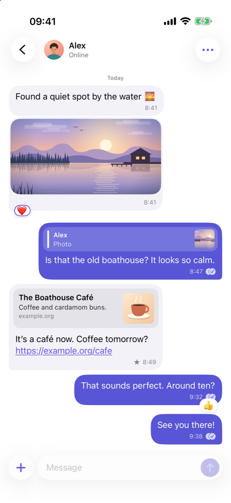

<div align="center">


# Haus XMPP

**A native XMPP messenger for iPhone, encrypted end to end with OMEMO.**<br>
Standard XMPP: any server, and people on any other XMPP client. A Mac app is on the way.

[**xmpp.haus**](https://xmpp.haus) · [Privacy](https://xmpp.haus/privacy/) · [Support](https://xmpp.haus/support/)


[](LICENSE)


<br>

<picture>
  <source media="(prefers-color-scheme: dark)" srcset="site/public/images/iphone-dark.jpg">
  
</picture>

</div>

<br>

> [!WARNING]
> **Haus XMPP is early software and not ready for personal conversations.** Most of what is listed below has been tested against a local Prosody test server, with disposable accounts and independent OMEMO implementations (python-omemo, QXmpp and libomemo.js) as the other side. Decrypted notification previews have been checked on a physical iPhone. Broad testing against other clients and servers, and a full release validation, have not been done yet. There are no public builds.

## What works

**Encryption**
- One-to-one chats, encrypted with OMEMO in both the original (`eu.siacs.conversations.axolotl`) and the current (`urn:xmpp:omemo:2`) profile.
- Encrypted private group chats (XEP-0045 members-only, non-anonymous rooms, `urn:xmpp:omemo:2` only). This is a restricted first implementation; see [Packages/OMEMO/GROUPS.md](Packages/OMEMO/GROUPS.md).
- Explicit device trust: a new or changed key is never trusted silently, and a message from an unverified device does not look verified. Message text in an encrypted chat is never sent unencrypted.

**Messaging**
- Reactions, replies, corrections, retractions, receipts, read markers and typing notifications.
- With `urn:xmpp:omemo:2`, reactions are encrypted. With the original profile, reactions, receipts and retractions travel as plain XEP-0444, XEP-0184 and XEP-0424 stanzas, because that is what clients on that profile understand.
- Encrypted file and photo sharing (XEP-0363 with XEP-0454), and link previews.

**Sync and notifications**
- Message history from the server archive (XEP-0313), stream resumption (XEP-0198), carbons and synchronised read state (XEP-0490), so several devices stay in step.
- Push notifications that the notification service extension decrypts on the device. The push gateway only sees a generic wake-up, never message content.

The Mac app (`HausXMPPMac`) shares the app model and stores, and has its own window, lifecycle and notification extension. Its conversation view is read-only for now, and push is turned off on the Mac.

The XMPP protocol stack is written for this app in Swift; it does not wrap or fork an existing XMPP library. The Double Ratchet and OMEMO key handling come from [libomemo-c](https://github.com/dino/libomemo-c) 0.5.1, vendored unmodified and pinned by hash.

## Building

Haus XMPP is developed with Xcode 27. The app targets iOS 26 and macOS 26; the Swift packages need Swift 6.0 or later. Older Xcode versions are untested.

```sh
git clone https://github.com/ellienieuwdorp/haus-xmpp.git
cd haus-xmpp
open HausXMPP.xcodeproj
```

Select the `HausXMPP` scheme and an iOS simulator, then Run. No developer account is needed for the simulator. Choose "Explore sample conversations" to try the interface without an account. The Mac app is the `HausXMPPMac` scheme.

`project.yml` is the source of the project configuration. After adding files or changing targets, regenerate the project with [XcodeGen](https://github.com/yonaskolb/XcodeGen) (`xcodegen generate`) and commit the result. The generated project is committed, so you don't need XcodeGen just to build.

### Local settings

Machine-specific build settings go in `Config/Local.xcconfig`, which is gitignored. Copy `Config/Local.xcconfig.example` and set what you need:

- `DEVELOPMENT_TEAM`: your team ID, to run on a device.
- `HAUS_STAGING_DOMAIN`: optional, the domain of your own test server. Debug builds launched with `-staging` sign in there over direct TLS on port 5223. Empty turns this off.

Debug builds are a separate development app: "Haus Dev", with its own icon, bundle identifier (`haus.xmpp.ios.dev`), App Group, Keychain items and data. It installs next to the TestFlight or App Store app and never sees its chats or keys. Release builds are "Haus XMPP" (`haus.xmpp.ios`). Every identifier derives from `HAUS_APP_ID` in `Config/Base.xcconfig`: the extensions add `.notifications`, the App Group is `group.` plus the bundle identifier, and Debug adds `.dev`.

The `haus.xmpp.ios` identifiers belong to the official app. To run on a device with your own team, set your own in `Config/Local.xcconfig`:

- `HAUS_APP_ID`: your bundle identifier, for example `com.example.chat`. Register it, `HAUS_APP_ID.dev` and their `.notifications` extensions, and the App Groups `group.HAUS_APP_ID` and `group.HAUS_APP_ID.dev`, or let Xcode's automatic signing do it.
- `HAUS_APP_NAME` and `HAUS_DEV_APP_NAME`: the names on the home screen, for Release and Debug.
- `HAUS_NOTIFICATION_FILTERING = NO`, unless Apple granted your extension's App ID the notification filtering entitlement (`com.apple.developer.usernotifications.filtering`). Apple grants it per App ID on request. Without it the notification extension cannot hide the push it was woken by, so after posting the new messages it replaces that push with a quiet "You may have new messages" entry that the next sync removes. Debug builds never have the entitlement, since the development App ID is a separate one.

[TRADEMARKS.md](TRADEMARKS.md) lists what a published fork must change.

Push notifications go through the project's push gateway, `push.xmpp.haus`, which can only notify the official app and its development build. A build with other identifiers connects and syncs normally but gets no push notifications.

### Signing in

Settings > Sign in takes a full address such as `name@example.org`. The app finds the server through the domain's SRV records, or uses the server entered under Advanced. A bare username signs in to a test server on `localhost` over direct TLS on port 5223, once you turn on "Use a disposable lab account".

## Tests

The protocol, storage and encryption code lives in Swift packages under `Packages/`, each with its own tests:

```sh
swift test --package-path Packages/XMPPProtocol
swift test --package-path Packages/MessageStore
swift test --package-path Packages/MessagingCore
swift test --package-path Packages/OMEMOCrypto
swift test --package-path Packages/OMEMO --parallel
python3 Packages/OMEMOCrypto/Scripts/verify_vendor.py   # checks the vendored crypto against its pinned hashes
```

The OMEMO suite is XCTest, which runs one class at a time unless `--parallel` is passed. The other packages use Swift Testing, which runs in parallel already.

Suites named `…LabTests` need a live test server and disposable accounts, passed in `HAUS_LAB_*` environment variables that each suite lists at its top, and are skipped otherwise. Some also need fixtures that are not in this repository (a second slixmpp client, a Prosody container for `prosodyctl`, a server with an unresponsive MUC component).

App-level tests run in Xcode: the `HausXMPPLifecycle` scheme for hosted unit tests ([AppLifecycleTests/README.md](AppLifecycleTests/README.md)) and the `HausXMPP` scheme for UI tests ([AppTests/README.md](AppTests/README.md)).

## Project layout

| Path | Contents |
|---|---|
| `App/`, `Shared/` | The app, shared by iPhone and Mac |
| `Mac/` | Mac-only views and lifecycle |
| `NotificationService/`, `NotificationServiceMac/` | Notification service extensions that decrypt push previews |
| `Packages/XMPPProtocol` | XMPP connection, stanzas and extensions |
| `Packages/MessageStore` | SQLite persistence |
| `Packages/OMEMO` | OMEMO device lists, trust and encryption policy |
| `Packages/OMEMOCrypto` | Swift and C bridge over the vendored libomemo-c |
| `Packages/MessagingCore` | Sending, sync, archive recovery and notification planning |
| `Config/` | Shared and local build settings |
| `TestPlans/` | UI test plans |

## Contributing and security

Read [CONTRIBUTING.md](CONTRIBUTING.md) before opening a pull request. Report security problems privately as described in [SECURITY.md](SECURITY.md), not in public issues.

## Licence

Haus XMPP is free software under the [GNU General Public License, version 3 or later](LICENSE), with an [additional permission](LICENSE-ADDITIONAL-PERMISSION) that allows distribution through the App Store, the Mac App Store and TestFlight. Because it includes libomemo-c, which is licensed under GPLv3 only, the app as a whole is distributed under GPLv3. Third-party components and their licences are listed in [THIRD_PARTY_LICENSES.md](THIRD_PARTY_LICENSES.md).

The name "Haus XMPP" and the app icon are not covered by the licence. Forks are welcome under a different name and icon; see [TRADEMARKS.md](TRADEMARKS.md).
